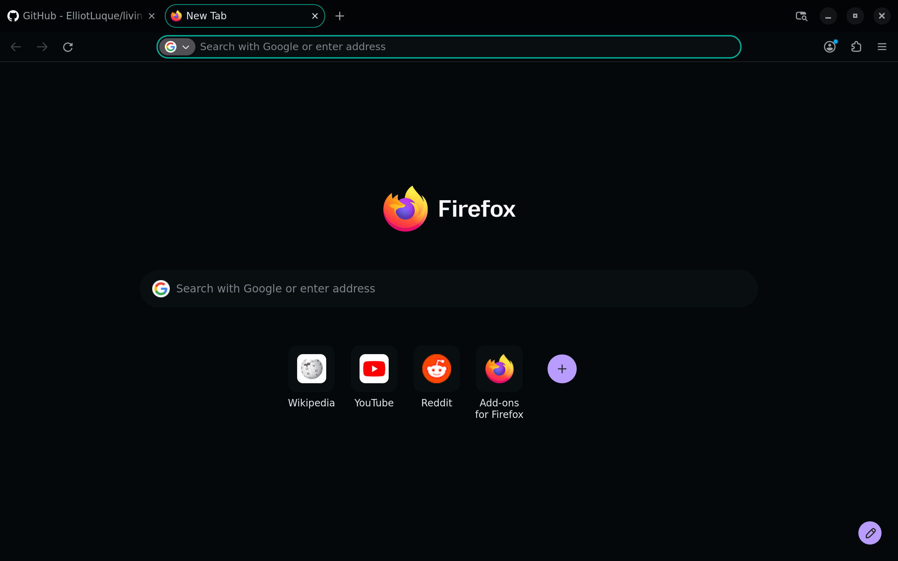
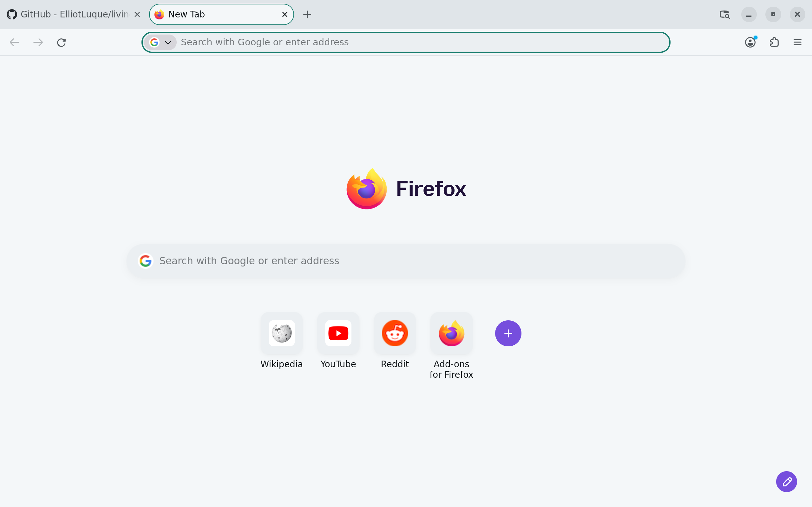

<!-- living-code-readme:1 -->
# 🦊 Living Code for Firefox

**Calm slate. Living color.** Living Code for Firefox. Repository-owned theme files, installation instructions and Night and Paper.

[Installation](#installation) · [Flavors](#flavors) · [Configuration](#configuration) · [All ports](https://github.com/living-code-theme)

## Previews

<table data-lc-flavors>
<tr>
<td width="50%" valign="top">
<strong>Night</strong> Dark · full palette  

</td>
<td width="50%" valign="top">
<strong>Paper</strong> Light · near-white slate  

</td>
</tr>
</table>

Select any preview to view the image at full size.

## Installation

Choose **Night** for a dark browser or **Paper** for a light one.

The organization-owned themes are not listed yet. Once published, find **Living Code Night** or **Living Code Paper** from **Living Code** on [Firefox Add-ons](https://addons.mozilla.org/firefox/themes/) and click **Install Theme**.

To switch themes, open **Add-ons and themes → Themes** (`about:addons`) and enable your preferred variant.

For packaging, run `node scripts/package.mjs` from a checkout. It writes `dist/living-code-firefox-night.xpi` and `dist/living-code-firefox-paper.xpi`. These files are unsigned; standard release Firefox requires AMO signing before installation.

## Flavors

Expand a flavor for its full-size preview and activation instructions.

<strong>Night</strong> · Dark · full palette

Once listed on [Firefox Add-ons](https://addons.mozilla.org/firefox/themes/), install **Living Code Night** from **Living Code**, then enable it in *Add-ons and themes → Themes*.

<strong>Paper</strong> · Light · near-white slate

Once listed on [Firefox Add-ons](https://addons.mozilla.org/firefox/themes/), install **Living Code Paper** from **Living Code**, then enable it in *Add-ons and themes → Themes*.

## Configuration

See [Firefox's documentation](https://www.firefox.com) for application settings and reload behavior. The activation instructions above identify each supported flavor; keep your other application configuration.

## Compatibility

Firefox 106 or newer. Only Night and Paper ship: Firefox's theme slots cannot meaningfully distinguish the other dark flavors. Release Firefox requires an AMO-signed theme; locally packaged XPI files are unsigned.

## Contributing

Found a problem? [Open an issue](https://github.com/living-code-theme/firefox/issues/new/choose) with the app version, the flavor and a screenshot. Want Living Code somewhere else? [Request a port](https://github.com/living-code-theme/core/issues/new?template=port-request.yml).

Pull requests are welcome. Keep this README, `port.json` and `images/` in sync, and use real screenshots of the app, never mockups.

🦎 **One chameleon, many habitats.** Part of [Living Code](https://github.com/living-code-theme).

## License

[MIT](LICENSE) © Elliot Luque
